<div align="center">

# 📊 GitHub Profile Charts

**Your GitHub stats as clean, animated SVG cards: private contributions included, light and dark mode, zero dependencies.**

[](https://github.com/hereisabrams/github-profile-charts/actions/workflows/test.yml)


<picture>
  <source media="(prefers-color-scheme: dark)" srcset="examples/hereisabrams/stats-dark.svg">
  
</picture>

<picture>
  <source media="(prefers-color-scheme: dark)" srcset="examples/hereisabrams/yearly-dark.svg">
  
</picture>
<picture>
  <source media="(prefers-color-scheme: dark)" srcset="examples/hereisabrams/monthly-dark.svg">
  
</picture>
<picture>
  <source media="(prefers-color-scheme: dark)" srcset="examples/hereisabrams/languages-dark.svg">
  
</picture>
<picture>
  <source media="(prefers-color-scheme: dark)" srcset="examples/hereisabrams/weekday-dark.svg">
  
</picture>

<sub>Live on <a href="https://github.com/hereisabrams">github.com/hereisabrams</a>. Switch GitHub's theme to see the other mode.</sub>

</div>

## Why another stats card?

- **Private work counts.** Most of us commit to private repos all day. The contribution calendar includes those
  counts, and these charts use it, so 11,000 private contributions don't show up as "3 commits this year".
- **No shared server.** The SVGs are generated in your own repository and committed next to your README. No
  public instance to hit rate limits, go down, or get cached for hours.
- **Light and dark, done properly.** Each chart ships as a light and a dark file with colors picked for that
  surface, not one file that looks wrong in one of the themes.
- **Readable by everyone.** A colorblind-checked palette, labelled legends, `aria-label`s on every chart, an
  optional Markdown table with the same numbers, and the grow-in animation switches off under
  `prefers-reduced-motion`.
- **Zero dependencies.** Plain Node 20+, about 500 lines you can read in one sitting.

## The charts

| Chart | Shows |
|---|---|
| `stats` | All-time and this-year contributions, merged PRs, longest and current streak, busiest day |
| `yearly` | Contributions per year since you joined |
| `monthly` | The last 12 months |
| `weekday` | Which days you actually work (weekends in a lighter shade) |
| `languages` | Languages weighted by **your commits** per repository, not by repo size |

## Set it up in 2 minutes

1. In your profile repository (`<username>/<username>`), add
   [`.github/workflows/profile-charts.yml`](examples/profile-charts.yml):

   ```yaml
   name: Profile charts
   on:
     schedule:
       - cron: '0 6 * * *'
     workflow_dispatch:
   permissions:
     contents: write
   jobs:
     charts:
       runs-on: ubuntu-latest
       steps:
         - uses: actions/checkout@v4
         - uses: hereisabrams/github-profile-charts@v1
   ```

2. Run it once from the **Actions** tab. The charts land in `profile-charts/`.

3. Put them in your README. Each chart has a `-light` and a `-dark` file:

   ```html
   <picture>
     <source media="(prefers-color-scheme: dark)" srcset="profile-charts/stats-dark.svg">
     
   </picture>
   ```

> [!TIP]
> To count private contributions, turn on **Settings → Public profile → Include private contributions on my
> profile**. Without it GitHub only reports public activity.

### Merged PRs and languages from private repos

The default Actions token can read your contribution calendar but not your private pull requests or
repositories. For the full picture, create a
[personal access token](https://github.com/settings/tokens) with the `repo` scope, save it as a repository secret
named `STATS_TOKEN`, and pass it in:

```yaml
- uses: hereisabrams/github-profile-charts@v1
  with:
    stats-token: ${{ secrets.STATS_TOKEN }}
```

Prefer not to store a token? Run the CLI on your own machine once (below). The numbers it saves to
`profile-charts/stats.json` are kept by later token-less runs, which only refresh the calendar charts.

## Options

| Input | Default | What it does |
|---|---|---|
| `user` | repository owner | Whose stats to draw |
| `out` | `profile-charts` | Output folder |
| `accent` | `blue` | `blue`, `violet`, `aqua`, `orange` or `pink` |
| `charts` | all five | Comma-separated subset, e.g. `stats,yearly` |
| `readme` | none | Writes a stats table between `<!-- PROFILE-CHARTS:START -->` and `<!-- PROFILE-CHARTS:END -->` |
| `subtitles` | built-in | JSON like `{"yearly":"Since day one","monthly":"{lastYearTotal} this year"}` |
| `stats-token` | none | Personal token that adds private PRs and languages |
| `commit` | `true` | Commit and push the result |

## Run it locally

```bash
git clone https://github.com/hereisabrams/github-profile-charts && cd github-profile-charts
node src/cli.mjs --user <your-login> --out ../<your-login>/profile-charts --accent violet
```

It uses `STATS_TOKEN`, `GITHUB_TOKEN`, or your [`gh`](https://cli.github.com) login, in that order.
`node src/cli.mjs --help` lists every flag.

## Contributing

Ideas and PRs are welcome: new chart types, accents, or anything that reads wrong for your account.
Run `npm test` before opening a PR.

## License

[MIT](LICENSE) © João Abrams
